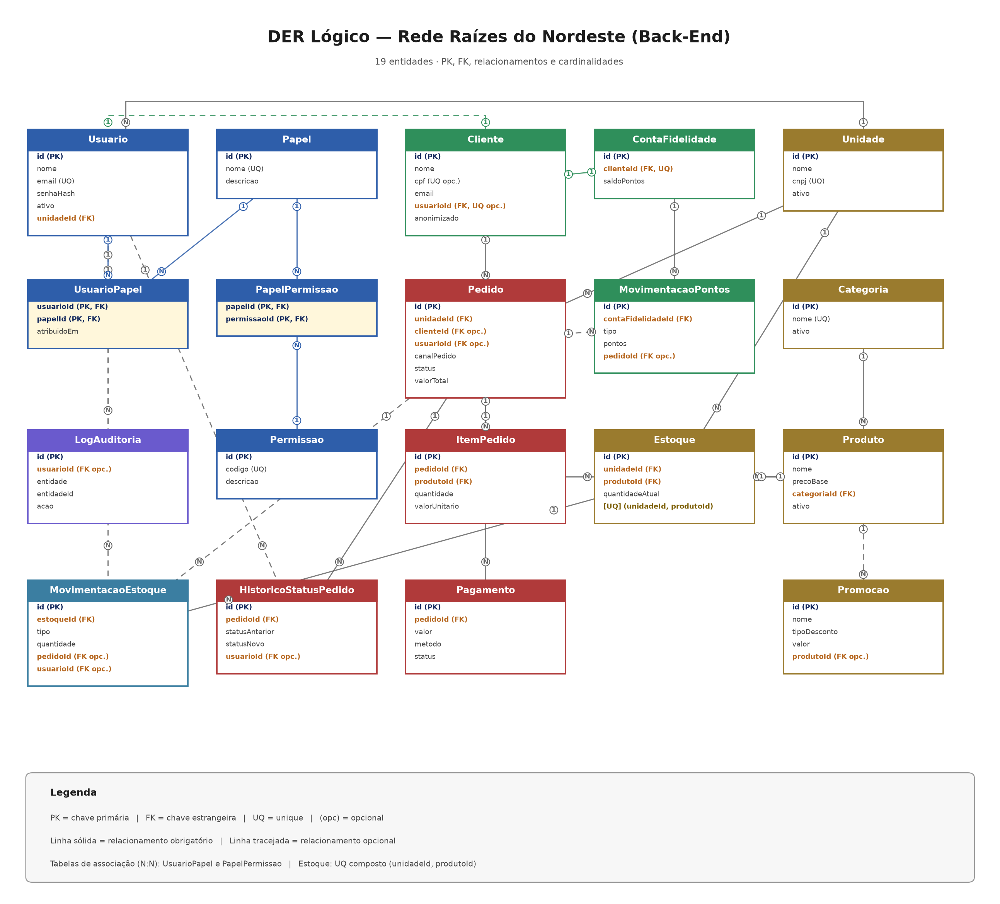

# Raízes do Nordeste — Backend

API REST do projeto multidisciplinar da rede fictícia **Raízes do Nordeste**.
Responsável por operações de usuários, unidades, produtos, estoque, pedidos,
pagamentos (simulados), fidelidade e promoções.

## Tecnologias

- Python 3.14.7
- Flask 3.1.3
- SQLAlchemy 2.x (via Flask-SQLAlchemy 3.1.1)
- Flask-Migrate 4.1.0 (Alembic)
- SQLite
- Flask-JWT-Extended 4.7.4
- Flasgger 0.9.7.1 (Swagger/OpenAPI)
- python-dotenv 1.2.4
- Werkzeug (hash de senha)
- Postman (testes manuais — opcional)

## Arquitetura

O projeto segue uma arquitetura em camadas:

```text
API
 ↓
Application
 ↓
Domain

Infrastructure
 ├── Database
 ├── Authentication
 ├── Payments
 └── Audit
```

- **API** — rotas REST, autenticação/autorização (JWT + RBAC), Swagger e
  tratamento padronizado de erros.
- **Application** — casos de uso (criação de pedido, baixa de estoque,
  pagamento, fidelidade, etc.).
- **Domain** — entidades, exceções e regras de negócio.
- **Infrastructure** — banco (modelos, repositórios, migrations, seed), JWT,
  mock de pagamento e auditoria.

## Estrutura de pastas

```text
app/
├── api/            # rotas, docs (Swagger), erros e schemas
├── application/    # casos de uso e interfaces (gateway de pagamento)
├── domain/         # entidades e exceções
└── infrastructure/ # database, auth, payments, audit

docs/
├── der/                       # DER lógico (PNG/PDF)
├── postman/                   # Collection + Environment + README
├── decisoes-de-escopo-e-premissas.md
├── especificacao-der.md
├── regras-de-negocio.md
└── lgpd-e-privacidade.md

tests/          # testes automatizados
migrations/     # migrations (Flask-Migrate/Alembic)
instance/       # banco SQLite (gerado, não versionado)
config.py       # configuração (lê o .env)
run.py          # ponto de entrada
requirements.txt
```

## Requisitos

- Python 3.14 (com `pip`)
- Postman (opcional, para os testes manuais)
- Git (opcional, para desenvolvimento)

## Instalação (Windows/PowerShell)

1. Crie o ambiente virtual:

   ```powershell
   python -m venv venv
   ```

2. Ative o ambiente virtual:

   ```powershell
   Set-ExecutionPolicy -Scope Process -ExecutionPolicy Bypass
   .\venv\Scripts\Activate.ps1
   ```

3. Instale as dependências:

   ```powershell
   python -m pip install -r requirements.txt
   ```

## Configuração

O projeto usa variáveis de ambiente. Crie o `.env` a partir do exemplo:

```powershell
Copy-Item .env.example .env
```

Edite o `.env` e defina uma chave JWT própria (nunca versione o `.env`).
Exemplo (valores **fictícios**):

```dotenv
SECRET_KEY=troque-por-uma-chave-secreta
JWT_SECRET_KEY=troque-por-uma-chave-jwt-com-32-bytes-ou-mais
DEBUG=True
# Opcional:
# DATABASE_URL=sqlite:///C:/caminho/para/raizes.db
# JWT_ACCESS_TOKEN_EXPIRES_HOURS=8
```

> `JWT_SECRET_KEY` deve ter **pelo menos 32 bytes**.

## Banco de dados

O projeto usa **SQLite** (arquivo em `instance/raizes.db`). Aplique as
migrations para criar o schema:

```powershell
flask --app run db upgrade
```

## Seed

O seed cria dados fictícios mínimos (unidade, categorias, produtos, estoque,
papéis, permissões, usuários e um cliente). É **idempotente** — pode ser
executado novamente sem duplicar dados:

```powershell
python -m app.infrastructure.database.seeds.seed
```

## Executar a aplicação

```powershell
python run.py
```

A API sobe em `http://127.0.0.1:5000`.

## Swagger

Documentação interativa (visualizar e testar os endpoints):

- UI: `http://127.0.0.1:5000/docs/`
- JSON OpenAPI: `http://127.0.0.1:5000/apispec_1.json`

## Principais funcionalidades

- Autenticação JWT
- Controle de papéis/permissões (RBAC)
- Estoque por unidade
- Pedidos (criação, consulta, status e cancelamento)
- Controle de status do pedido
- Cancelamento com devolução de estoque
- Pagamentos simulados (mock)
- Fidelidade (acúmulo e resgate de pontos)
- Promoções (sem acúmulo de descontos)
- Auditoria de ações sensíveis
- Anonimização de cliente (LGPD)
- Documentação OpenAPI

## Endpoints (resumo)

A documentação completa fica no **Swagger** (`/docs/`). Resumo das rotas:

**Auth**
- `POST /auth/login`
- `GET /auth/me`

**Estoque**
- `GET /estoque`
- `POST /estoque/entrada`
- `POST /estoque/saida`
- `POST /estoque/ajuste`

**Pedidos**
- `POST /pedidos`
- `GET /pedidos`
- `GET /pedidos/{id}`
- `PATCH /pedidos/{id}/status`
- `POST /pedidos/{id}/cancelamento`
- `GET /pedidos/{id}/pagamentos`

**Pagamentos**
- `POST /pagamentos`
- `GET /pagamentos/{id}`

**Fidelidade**
- `GET /clientes/{id}/fidelidade`
- `POST /clientes/{id}/fidelidade/resgate`

**LGPD**
- `POST /clientes/{id}/anonimizacao`

## Testes

O projeto possui **130 testes automatizados passando**, cobrindo:

- autenticação (auth)
- RBAC
- estoque
- pedidos
- pagamentos
- fidelidade
- promoções
- integração
- documentação (Swagger)
- LGPD/auditoria

Cada módulo de teste define seu próprio banco temporário, então execute-os em
processos separados:

```powershell
python -m unittest tests.test_auth
python -m unittest tests.test_rbac
python -m unittest tests.test_estoque
python -m unittest tests.test_pedidos
python -m unittest tests.test_pagamentos
python -m unittest tests.test_fidelidade
python -m unittest tests.test_promocoes
python -m unittest tests.test_integracao
python -m unittest tests.test_docs
python -m unittest tests.test_auditoria_lgpd
```

## Postman

Testes manuais da API (complementar ao Swagger):

- `docs/postman/raizes-do-nordeste.postman_collection.json`
- `docs/postman/raizes-do-nordeste.postman_environment.json`
- `docs/postman/README.md`

Importe a Collection no Postman (**Import** → arquivo → selecione o JSON). A
autenticação **Bearer** é configurada no nível da Collection; rode o request
**Login** primeiro para que o `token` seja preenchido automaticamente.

> A Collection foi **validada estruturalmente** e suas URLs foram conferidas
> com as rotas reais da aplicação. Ela **não** foi executada dentro do Postman
> neste ambiente.

## LGPD e privacidade

- Senha armazenada apenas como **hash** (nunca em texto puro, respostas ou auditoria);
- Autenticação via **JWT** (segredo em variável de ambiente, não gravado no banco);
- **Controle de acesso** (RBAC + escopo por unidade; cliente acessa só os próprios dados);
- **Auditoria** de ações sensíveis (`LogAuditoria`);
- **Mascaramento** de dados sensíveis na auditoria;
- **Consentimento** para comunicações (`aceitaComunicacoes` / `consentimentoEm`);
- **Anonimização** de cliente (`POST /clientes/{id}/anonimizacao`);
- **Não armazenamento** de dados reais de cartão (pagamento é mock).

Detalhes em [`docs/lgpd-e-privacidade.md`](docs/lgpd-e-privacidade.md).

## DER

Diagrama Entidade-Relacionamento lógico:

- [`docs/der/der-logico.png`](docs/der/der-logico.png)
- [`docs/der/der-logico.pdf`](docs/der/der-logico.pdf)



## Credenciais de desenvolvimento

Usuários criados pelo seed (**somente desenvolvimento/testes**):

| Usuário | E-mail | Senha |
|---|---|---|
| Administrador da rede | `admin@raizes.dev` | `Admin@123` |
| Atendente (unidade) | `atendente@raizes.dev` | `Atendente@123` |

> Nunca usar essas credenciais em produção.

## Limitações / decisões

- O **pagamento é um Mock** (gateway simulado); não usa gateway real nem dados reais de cartão.
- `simularResultado` é um **recurso de desenvolvimento** do mock (força aprovado/recusado) — não usar em produção.
- **SQLite** é utilizado no MVP.
- A **expiração automática de pontos** não foi implementada (a operação está preparada no modelo).
- **Promoções não acumulam descontos**: aplica-se apenas a de maior benefício.
- Os **valores monetários** (valorProdutos, valorDesconto, valorTotal, valorUnitario) são **sempre calculados pelo servidor**; valores enviados pelo cliente são ignorados.
